# The Pure — screen preview (demo build, Nov 14 2026)

Every screen in the current demo build, in workout order. Captured on a 412 × 915 phone-size browser with **fictional data** and a **simulated** heart-rate strap and voice; nothing here comes from a real workout. Live app: https://the-pure-ready-test.onrender.com

**Flow:** 1 Ready → Start → 2 Workout (Round 1 → Recovery → Round 2) → 3 Results (cooldown) → back to Ready.

---

## 1 · Ready screen
The first screen you see. Today's 3 exercises with rung and gear, heart-rate pairing, Start Workout and Practice.

| 1a · No heart-rate strap yet | 1b · Strap paired, live BPM |
|---|---|
|  | 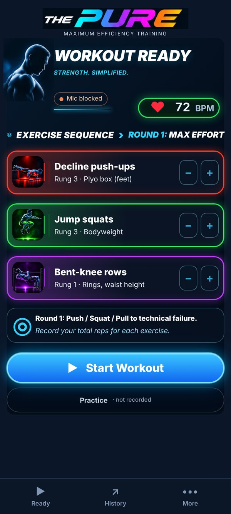 |

**Sub-screens of Ready**

| 1c · Exercise order (tap EXERCISE SEQUENCE ›) | 1d · Start without a strap: one check, then go |
|---|---|
| 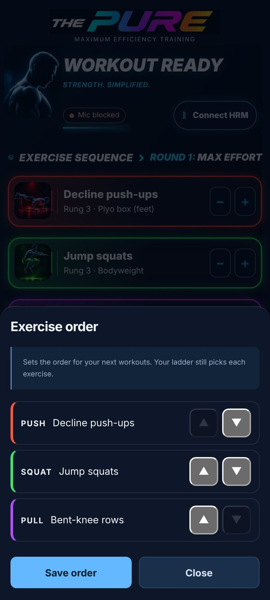 | 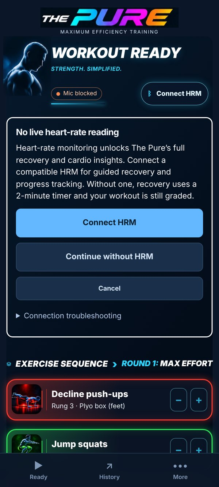 |

---

## 2 · Workout screen
The workout itself: one big current exercise, the Push / Squat / Pull strip, live BPM, and tiny LIVE and mic markers.

| 2a · Start (3-second get-ready) | 2b · Round 1, Push | 2c · Push saved, moving to Squat |
|---|---|---|
| 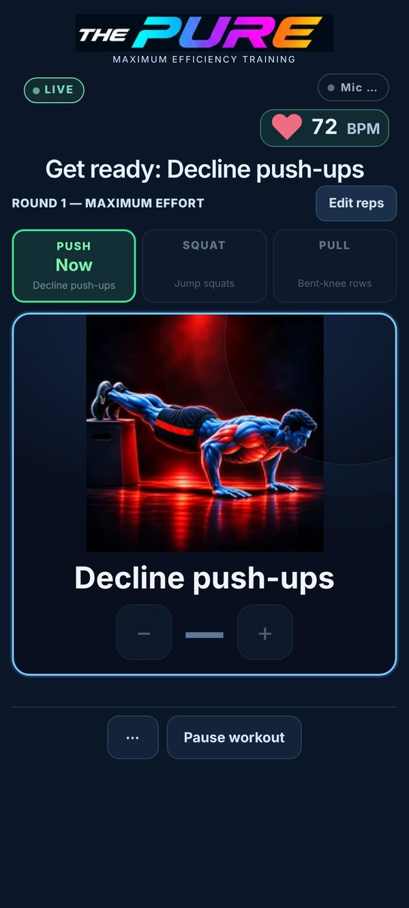 |  | 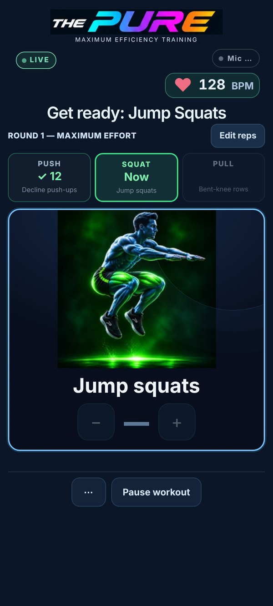 |

| 2d · Voice heard "60", asks to confirm | 2d2 · Squat saved, Pull is now |
|---|---|
| 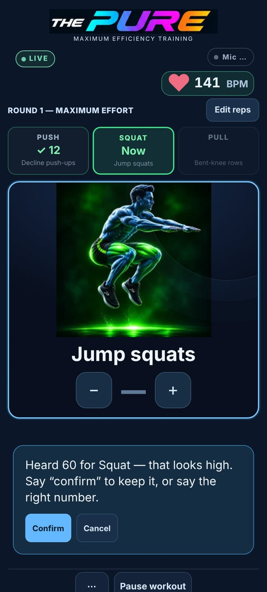 | 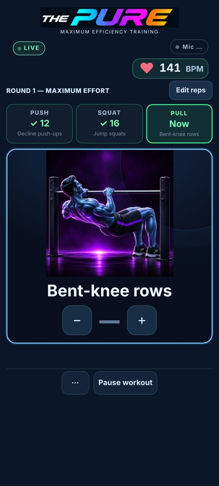 |

**Sub-screens of Workout**

| 2e · ⋯ menu (Sound, Abort, Finish & save) | 2f · Sound mix | 2g · Edit reps | 2h · Paused |
|---|---|---|---|
| 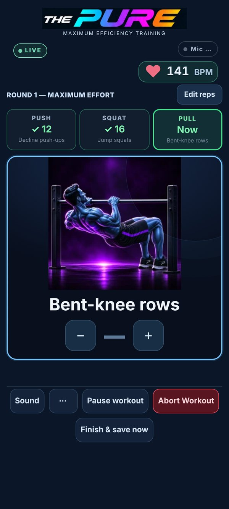 | 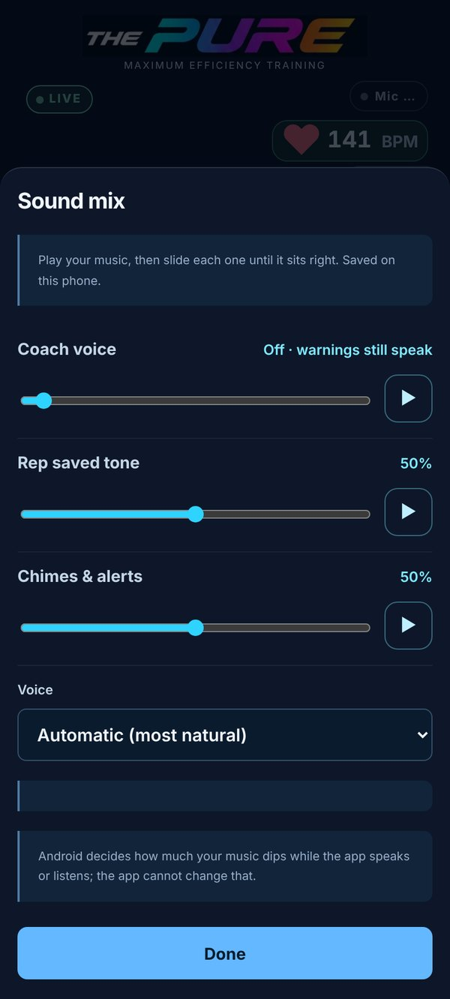 | 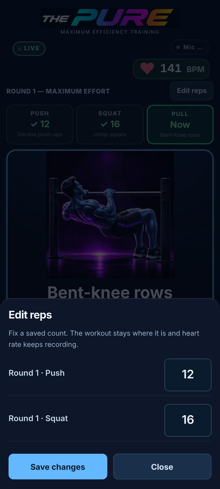 | 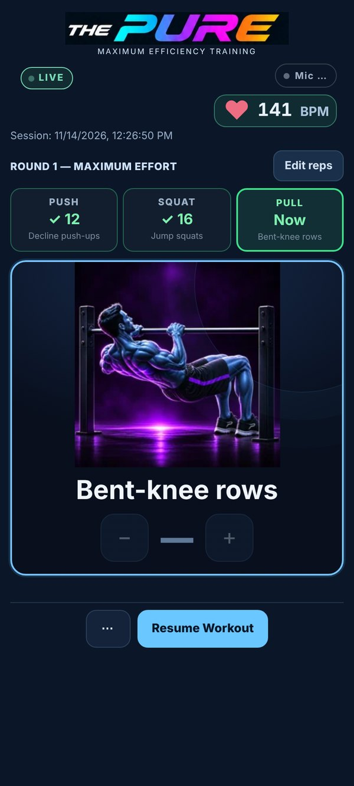 |

**Between rounds**

| 2i · Recovery: breathe, 110 target, timer counting up, Hold | 2j · Round 2 starts by itself at 110 BPM or below |
|---|---|
| 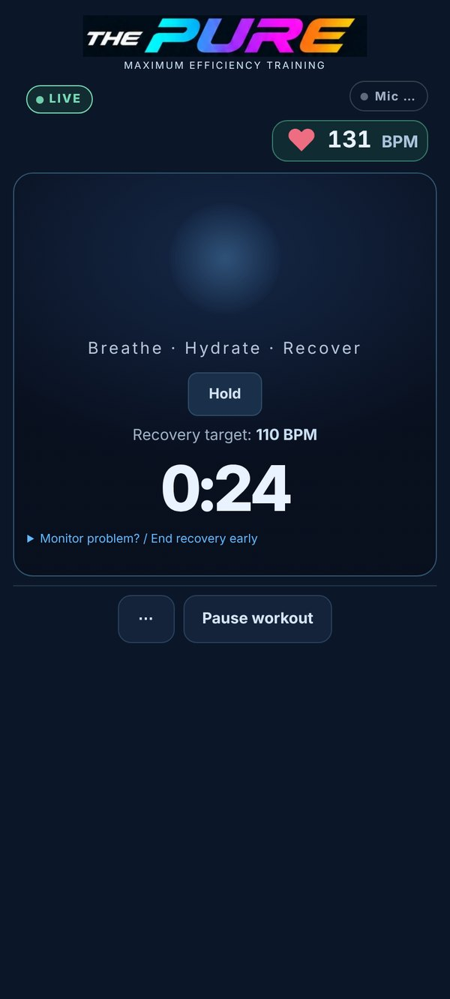 | 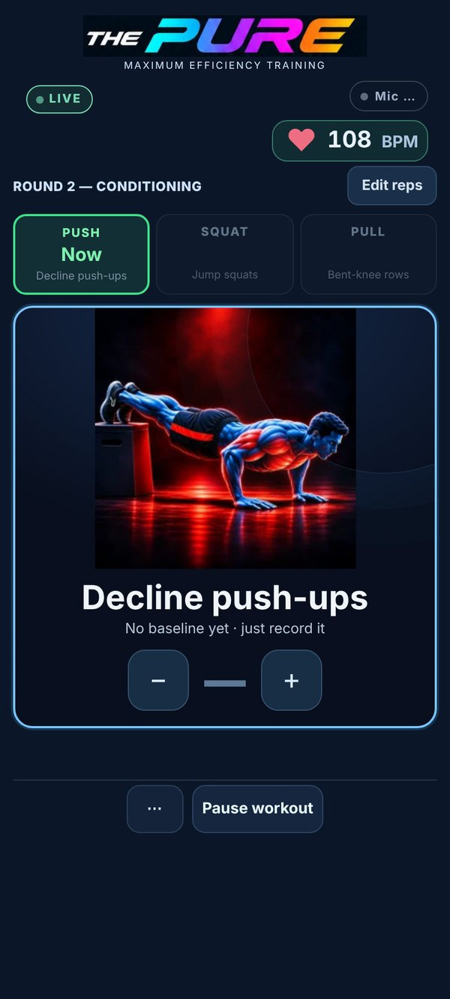 |

---

## 3 · Results screen
Appears as soon as the last Round 2 count saves. The workout is already saved; heart rate keeps recording through the cooldown, which ends by itself at 100 BPM or below.

| 3a · During cooldown (top of screen) | 3b · After cooldown (top of screen) |
|---|---|
| 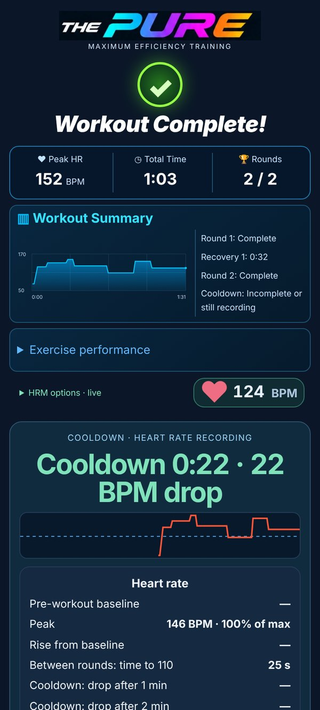 | 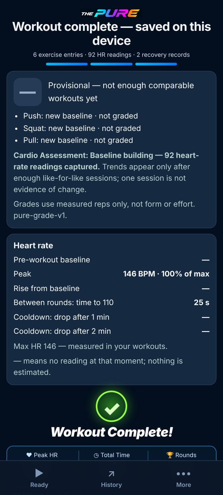 |

Full scrolling pages: [3a during cooldown](3a-cooldown-results-full.jpg) · [3b final](3b-results-final-full.jpg)

**Then:** reopening the app goes back to Ready.

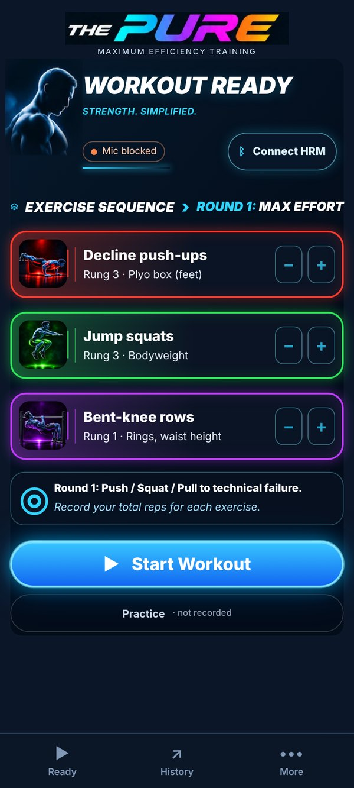

---

### Known gaps (honest list)
- **Results:** layout is still waiting on Chat's audit. "Workout Complete" appears twice, and the round reps are behind a collapsed "Exercise performance".
- **Art:** only 3 of the 21 exercise images are final. The big workout image is a small file, so it looks soft.
- **Mic marker:** the "Mic …" in these shots is the simulated voice. On the phone it shows the real state.
- **Not yet checked on a real Android phone:** microphone, heart-rate strap, voice volume over music.
